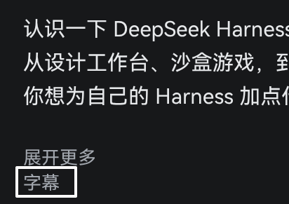

# Bilibili transcript copy

A userscript that puts one pill right after the 「展开更多」 toggle in a B站 video description. Click
it and the transcript of the part playing now goes to your clipboard.

It runs inside the watch page and reuses that tab's cookies, so there is no server to run and no
token to paste in.

## Install

1. Add a userscript manager: [Tampermonkey](https://www.tampermonkey.net/) or
   [Violent Monkey](https://violentmonkey.github.io/).
2. Create a new script and paste all of `bilibili-transcript-fetcher.user.js`, `==UserScript==` header included.
3. Allow the request to visit external sites when the manager asks (the script calls `api.bilibili.com`).
4. Open a `bilibili.com/video/BV…` page in a tab that is logged in.

`@match` covers `www.bilibili.com/video/*`, `/en/video/*` and `bilibili.com/video/*`, so the script
does nothing on any other page.

Where the manager provides `GM_xmlhttpRequest` and `GM_setClipboard`, the script uses them: no CORS,
and the tab's cookies ride along. Otherwise it falls back to `fetch` and
`navigator.clipboard.writeText`.

## Using it

The pill copies the look of the 展开更多 toggle: same background, text colour, size and radius. The
label follows the page language, 字幕 on a Chinese page and Transcript on the English one.

Click it and:

1. the label changes to 获取… or Fetching…
2. the transcript lands on the clipboard as plain text, one cue per line, timestamps dropped
3. a note under the description reports the character count, which track and which part, then fades
   out after a few seconds
4. the label returns to normal

The part number comes from `?p=`, then from the page state, and is checked against the part list.
When the page state is stale the script asks the part list again instead of assuming P1, and it only
fetches the part playing now.

Track order: `zh-Hans`, `zh-CN`, `ai-zh`, any other `zh…`, then whatever the list has first. The note
says which one was used.

## Messages

| You see | It means |
|---|---|
| `subtitle list empty — this tab is not logged in (AI subtitles also come back empty logged out)` | Login-gated tracks come back empty when logged out. An empty list is reported as a login problem, never as a missing subtitle. |
| `no subtitle track for this part` | Logged in, and the part really has none. |
| `B 站 throttled this IP（风控）— retry later` | Risk control answered. The script refreshes its keys, retries once, then stops. |
| `copy failed: <reason>` | Anything else: HTTP status, a body that is not JSON, a refused clipboard. |
| `self-check failed: <case>` | The signing code is wrong. Reported as the page loads, before the button can copy the wrong text. |

## How it works

`window.__INITIAL_STATE__` or the part list identifies the video, `x/web-interface/nav` supplies the
current WBI keys, a signed `x/player/wbi/v2` call returns the subtitle list, and each track body is
plain JSON.

The signature is the point. Under risk control the unsigned player endpoint answers HTTP 200 with
valid JSON carrying another video's subtitles, and the response gives no hint. When a signature is
rejected (`-352`, `-403`, HTTP 412) the script drops the cached keys and retries once. Keys live for
10 minutes per tab.

No cookie or token is read, printed or stored.
